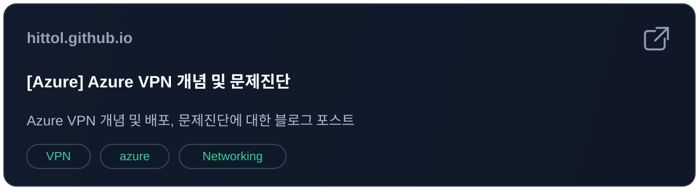

<!-- ================= HEADER ================= -->

  

 

<!-- ================= TECH STACK ================= -->

<h2>Tech Stack</h2>

  

---

<!-- ================= BLOG ================= -->

<h2>📓 Blog 📓</h2>

